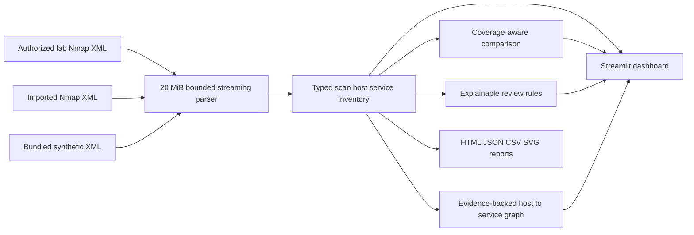
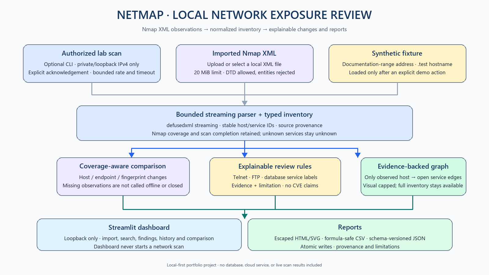

# NetMap

NetMap is a local-first network exposure review tool for **authorized lab scans** and imported Nmap XML. It normalizes the observations, shows what changed between snapshots, applies a small set of explainable defensive review rules, and exports evidence-based reports. The dashboard never launches a scan or uploads data to a service.

The repository's built-in demonstration is synthetic. Its address is in the documentation-only `192.0.2.0/24` range, its hostname ends in `.test`, and its reports are labeled synthetic. No live scan results or packet captures are included in the working tree.

## What is implemented

- Streaming Nmap XML parsing with a 20 MiB input limit, malformed/empty-file handling, duplicate endpoint normalization, optional-field handling, scan coverage, completion status, and stable host/service identifiers.
- A typed inventory model for scan, host, and service observations. Service identification is distinguished as confirmed, inferred, or unknown.
- Coverage-aware two-snapshot comparisons. Explicit `closed` or `filtered` rows are state changes; missing endpoints are labeled as newly observed, no longer observed, not assessed, or hosts not observed. Missing data is not described as offline or closed.
- Explainable review signals for reported Telnet, FTP, and database services. They describe defensive review priorities, not confirmed vulnerabilities, CVEs, exploitability, or CVSS.
- Streamlit dashboard with an explicit synthetic-demo button, XML upload/local saved-scan import, overview, searchable inventory, findings, scan history, comparison, and evidence-backed host-to-service map.
- HTML, JSON (`netmap.report.v1`, schema at [docs/report-schema-v1.json](docs/report-schema-v1.json)), CSV findings and inventory, and SVG map exports. HTML/SVG text is escaped, CSV formula-like values are quoted, and report writes are atomic.
- An optional Nmap CLI limited to private or loopback IPv4 targets, up to 256 discovery addresses, up to 2,048 ports per scan, a 1–600 second timeout, a 100 packet/second cap, two retries, and an explicit `--authorized-lab-target` acknowledgement.
- CI for unit and Streamlit AppTest flows, Python compilation, dependency consistency, and dependency auditing.

## Architecture and data flow



See [ARCHITECTURE.md](docs/ARCHITECTURE.md) for data structures, trust boundaries, and algorithm details; [INTERVIEW_GUIDE.md](docs/INTERVIEW_GUIDE.md) for a technical walkthrough.



## Installation

Python 3.11 or later is recommended. Nmap is optional and only needed for the active CLI commands. The dashboard dependencies are pinned in `requirements.txt`.

### Windows PowerShell

```powershell
py -3 -m venv .venv
.\.venv\Scripts\Activate.ps1
python -m pip install --upgrade pip
python -m pip install -r requirements.txt
```

### Linux/macOS

```bash
python3 -m venv .venv
. .venv/bin/activate
python -m pip install --upgrade pip
python -m pip install -r requirements.txt
```

## Run the synthetic demo

From the repository root:

```powershell
py netmap.py demo
py -m streamlit run dashboard.py
```

The CLI creates ignored files under `outputs/demo/`: baseline/after JSON, inventory CSV, findings CSV, HTML, SVG, and a comparison CSV/HTML. In the dashboard, click **Load synthetic demonstration** to load the fixture into the overview. The UI labels it **SYNTHETIC DEMONSTRATION DATA — NOT A LIVE SCAN**. The app does not load fixtures automatically.

## Import an Nmap XML scan

For the dashboard, start it locally and select **Upload a scan**, or place XML files in the local-only `scans/` folder and select one. Uploads and parsed results stay in the local Streamlit process. Each XML file is limited to 20 MiB.

The CLI can create reports without a dashboard:

```powershell
py netmap.py report path\to\authorized-scan.xml --csv outputs\ports.csv --hosts-csv outputs\hosts.csv --html outputs\report.html --json outputs\report.json --findings-csv outputs\findings.csv --svg outputs\map.svg
py netmap.py compare path\to\baseline.xml path\to\later.xml --csv outputs\changes.csv --html outputs\comparison.html
```

An output path cannot overwrite either XML input. Report contents include scan timestamp and source basename; JSON also includes source kind, scanner metadata, scan coverage/completion, inventory, findings, and limitations.

## Optional authorized lab scanning

The Streamlit dashboard does not scan. The CLI requires a separate acknowledgement flag and rejects hostnames, public targets, IPv6, broad ranges, and excessive port lists. These controls help bound accidental use; they do not prove that you have permission. Scan only systems and private/loopback ranges you own or have explicit authorization to test.

```powershell
py netmap.py scan 192.168.56.101 --authorized-lab-target --scan-type connect --ports 22,80,443 --timeout 120 --xml scans/lab.xml
py netmap.py discover 192.168.56.0/24 --authorized-lab-target --timeout 180 --xml scans/discovery.xml
```

Both commands require Nmap. This audit environment did not have Nmap available, so no scan was run; tests mock the subprocess and do not require network access. The helper `windows_live_scan.ps1` also asks for a typed `SELF` acknowledgement before calling the bounded single-host command.

## How comparison works

NetMap compares endpoint keys `(address, protocol, port)` and service fingerprints. Explicit `open → filtered` or `open → closed` changes are reported with both observations. An open endpoint absent from later XML is only considered `no_longer_observed` when the later scan is complete, the host is present, and the later `scaninfo` covers that port. Otherwise it is `not_assessed`. A missing host is `host_not_observed`; it is not marked offline or removed. A new open endpoint is `newly_observed_open` with a limitation because its baseline might not have covered it. Rule-match changes are reported separately and do not prove remediation.

## Review rules

| Rule | Signal | Severity | Interpretation |
| --- | --- | --- | --- |
| `NETMAP-CLEAR-TEXT-TELNET` | Reported Telnet service is open | Medium | Review exposure and replace with a managed encrypted remote-access option where feasible. |
| `NETMAP-CLEAR-TEXT-FTP` | Reported FTP service is open | Medium | Review exposure and prefer SFTP/FTPS with managed credentials. |
| `NETMAP-DATABASE-REACHABLE` | Reported database service label is open | Medium | Restrict access and review authentication and transport configuration. |

The input's service name is evidence, not a confirmed software identity unless Nmap reports `method="probed"`. No CVE feed, exploitability engine, or CVSS scoring is implemented. See [SECURITY.md](SECURITY.md) for assumptions and limitations.

## Tests and audit

```powershell
py -m pip install -r requirements-dev.txt
py -m unittest discover -s tests -v
py -m py_compile netmap.py netmap_models.py dashboard.py tests\test_netmap.py tests\test_dashboard_overview.py
py -m ruff check netmap.py netmap_models.py dashboard.py tests\test_netmap.py tests\test_dashboard_overview.py
py -m ruff format --check netmap.py netmap_models.py dashboard.py tests\test_netmap.py tests\test_dashboard_overview.py
py -m pip check
py -m pip_audit -r requirements-dev.txt
```

Tests use only synthetic fixtures and temporary files. They cover malformed and oversized XML, duplicate endpoints, coverage-aware comparisons, rule evidence, safe HTML/SVG/CSV/JSON output, output/input collision checks, private target bounds, authorization acknowledgement, CLI demonstration, dashboard empty/demo/upload/comparison states, and filters.

## Known limitations

- The project is a local portfolio tool, not a multi-user service. It has no authentication, database, cloud deployment, or remote data retention.
- Scan history is derived from local XML files; it is not a durable asset database. First-seen/last-seen across historical scans are not asserted.
- Nmap command execution was not live-tested in this environment. No target was scanned during this work.
- Exposure rules are a deliberately small review list and can be false positive or incomplete. They do not validate vulnerability status.
- Endpoint comparisons depend on Nmap XML coverage and completeness. Different options or network filtering can limit conclusions.
- The visual graph is capped at 250 host and 250 service nodes for readability. The full inventory remains available in tables and exports.
- The existing open remediation PR removes scan evidence from the current tree, but historical Git commits are unchanged. If historic artifacts are sensitive, repository owners must decide on history cleanup separately.

## Troubleshooting

- **Nmap not found:** install Nmap separately and confirm `nmap --version`; XML import, dashboard, tests, and synthetic demo do not require it.
- **No saved scans:** upload XML or click **Load synthetic demonstration**. The latter uses only bundled, labeled synthetic data.
- **Large or malformed XML:** reduce the file below 20 MiB or generate a valid Nmap XML export. Invalid inputs are rejected without loading stale dashboard data.
- **Graph unavailable:** review the host/service edge table and the full Ports & Services inventory.
- **PowerShell virtual environment activation blocked:** use `\.venv\Scripts\python.exe -m pip install -r requirements.txt` and `\.venv\Scripts\python.exe -m streamlit run dashboard.py` without activation.
