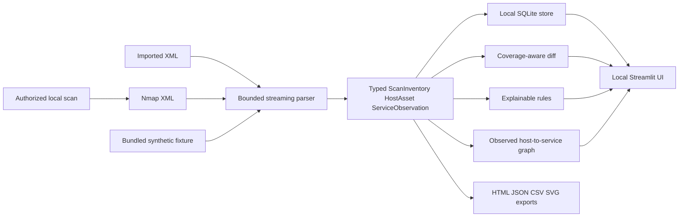

# NetMap architecture

## Data flow

The Streamlit app reads local files or user uploads and does not execute Nmap. The optional CLI owns the only active-scanning path. The database is a user-local SQLite file; there is no server-side database, cloud integration, or remote telemetry.

## Modules and data structures

- `netmap.py` contains XML ingestion, validation, analysis, comparison, report writers, and CLI entry points. The parser uses `defusedxml.ElementTree.iterparse` (allowing Nmap's normal DTD while forbidding entities and external references), clears each host element after normalization, and rejects files larger than 20 MiB.
- `netmap_models.py` defines immutable `HostAsset`, `ServiceObservation`, and `ScanInventory` records. `to_record()` provides a boundary to the existing DataFrame and JSON interfaces.
- `dashboard.py` adapts a selected scan to Streamlit. It keeps the current selection in session state and parses uploads in temporary directories using a fixed internal filename.
- `netmap_store.py` owns local SQLite schema version 1, snapshot deduplication, host/service observations, finding triage events, saved comparisons, backups, restores, and deletion.
- `sample_data/` contains synthetic-only XML fixtures in documentation IPv4 space with `.test` names. The dashboard loads them only after an explicit button click.

Host IDs are SHA-256 prefixes of the normalized address. Service IDs combine the host ID, protocol, and normalized port. Scan IDs derive from the XML scanner, timestamp, and scan arguments; raw scan arguments are not emitted in reports.

## Local persistence

Operational data defaults to the platform application-data directory and can be configured with `NETMAP_DATA_DIR` or `NETMAP_DB_PATH`. Synthetic demo data uses a separate `demo.sqlite3`. Imports are deduplicated by source kind and content digest. Host and service observations are indexed per snapshot; finding observations and event history preserve review state over time. Missing coverage never automatically resolves findings. Backup uses SQLite's online backup API. Restore requires explicit confirmation and validates integrity, foreign keys, supported schema version, and exact schema before replacing the database; an existing database receives a neighboring pre-restore backup. Snapshot deletion cascades related observations and comparisons and removes findings with no remaining observations.

## Parser and coverage behavior

The parser validates the root element, rejects empty/malformed/oversized files, normalizes IP text, lowercases protocol/state, normalizes numeric ports, ignores invalid port values, and deduplicates hosts and endpoints. It records missing service identification as `unknown`; Nmap's `method="probed"` is `confirmed`, other named service labels are `inferred`.

When present, `scaninfo` becomes per-protocol port coverage. Nmap's `runstats/finished` is used as the completion flag. Missing metadata remains unknown; NetMap does not invent a default coverage range or completion status.

## Comparison algorithm

1. Key explicit port records by `(normalized address, protocol, port)`.
2. Compare state and fingerprint only when both snapshots report the endpoint.
3. Report an endpoint that appears only in the later XML as `newly_observed_open` with low confidence; the baseline may not cover it.
4. Report an earlier open endpoint as `no_longer_observed` only when the later scan records the host, declares completion, and covers that port. Otherwise use `not_assessed`.
5. Report hosts absent from the later scan as `host_not_observed`, never as offline or removed.
6. Compare rule-match identities separately; a rule no longer matching is not evidence of remediation.

Every change includes both source names/timestamps and a limitation string. No cryptographic identity of hosts is asserted beyond the local address-based identifier.

## Rules and graph

Rules consume open service observations and return stable rule IDs, severity, evidence, explanation, source, timestamp, and next steps. The rules cover clear-text Telnet/FTP and reported database services. They are configuration-review signals and have no vulnerability database.

The graph contains only observed hosts, open services, and host-to-service edges. No network routes or host-to-host links are inferred. Display/export graphs cap at 250 host nodes and 250 service nodes; complete records remain in the inventory and CSV/JSON reports.

## Reports and security boundaries

- HTML output escapes text and attribute content and includes provenance, host inventory, service rows, rule signals, and limitations.
- SVG output is generated from a fixed template with escaped text and numeric coordinates.
- CSV output prefixes spreadsheet-formula-like values with an apostrophe.
- JSON output is `netmap.report.v1`, sorted, and deterministic for a fixed scan; generated time is the scan timestamp.
- File writes use a temporary file in the target directory followed by `os.replace`. CLI refuses to overwrite XML inputs.
- Active scan targets are private/loopback IPv4 only, require an explicit acknowledgement, cap discovery and ports, use an array-form subprocess call, rate/retry bounds, and a process timeout.
- Streamlit binds to `127.0.0.1`, enables CORS/XSRF protections, disables static serving, and limits uploads to 20 MiB.

This is a local portfolio application. The controls reduce accidental unsafe use; they do not replace authorization or constitute a production security certification.
